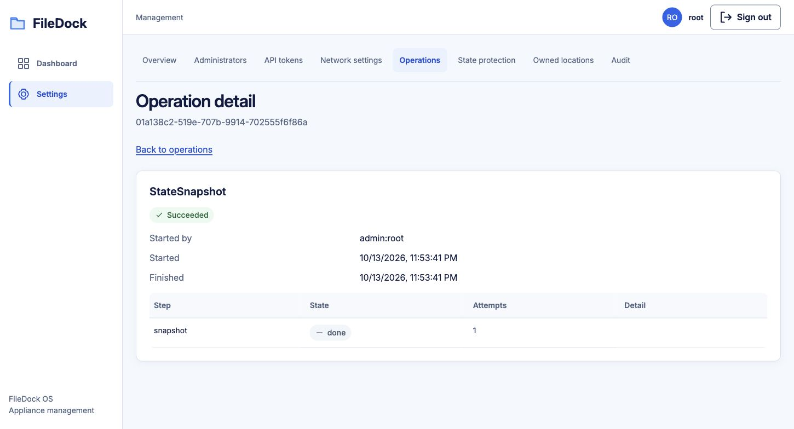

# Phase 6–7 PVE smoke test — 2026-10-13

**Result: PASS for installed configuration protection and isolated configuration recovery.**
This is not full remote-storage or data-plane disaster-recovery acceptance.

## Environment

- Existing VM: `192.168.68.26`, Debian 13.7 amd64, approximately 4 GiB RAM.
- Installed packages: filedock-core, filedock-management, filedock-builtins `0.1.0`.
- Management: HTTP `8021`. SSH through kyson with root accessed using `su`; direct root SSH was refused.
- Core binary SHA-256: `6a628c6d210a8bccfcd186b2b2f44a79df957fd5a01307e13eb58c9375132d8e`.
- Management binary SHA-256: `f023549d85d4ea66d2c7813414170ca9afac0ae06a17752becfaf4b1cf5120b0`.
- All eight reported components were healthy: Core, Management, Docker, fd-s3, Kopia, NFS, rclone, Samba.

## Installed appliance checks

| Check | Result | Evidence |
| --- | --- | --- |
| Public `/health` | PASS | HTTP 200, status ok |
| Protected state endpoints | PASS | Anonymous state-protection request returned 401; administrator sign-in succeeded |
| System health | PASS | Eight reported components healthy |
| Forced snapshot | PASS | API operation succeeded; current system-disk copy had no error |
| Backup download | PASS | 7,168-byte tar; safe regular-file paths; one snapshot; FDSTATE header; size and SHA-256 matched signed-index entry metadata (MAC verification was exercised separately by restore) |
| Authentication exclusion | PASS | Sign-out/sign-in and audit writes produced no new snapshot over a 36-second observation window |
| Automatic configuration snapshot | PASS | Temporary administrator creation reached the system-disk copy in **33.88 seconds** |
| Read-only token permissions | PASS | Could read protection; snapshot and key-regeneration requests returned 403 |
| Fresh-target guard | PASS | Restore request and console restore detection refused the configured appliance |
| Console status/export | PASS | filedockctl present; state status and state export succeeded; exported backup mode 600 |
| Copy integrity/configuration scope | PASS | Seven retained entries passed header/size/SHA checks; Management section contained configuration fields and no session/audit/setup history |
| Temporary account cleanup | PASS | Smoke administrator deleted, token revoked, final snapshot requested; existing root and kason administrators remained |

Console backup retained on the VM: `/root/filedock-phase67-20261013-235151.fdbackup`.
A separately downloaded encrypted backup is at `/tmp/filedock-pve-phase67/current-installation.fdbackup` on the local workstation. Neither recovery-key rotation nor restore was performed against the installed appliance.

## Isolated recovery checks on the same VM

With explicit user approval, two smoke runs used the **installed Linux binaries**, private temporary databases/sockets, randomly selected localhost HTTP ports, separate copy roots, and disabled runtime orchestration. Production recovery-key KDF settings were used. Each run generated its own test key; no installed-appliance key was needed or changed.

- Initial setup, key confirmation, encrypted snapshot and backup export passed.
- Five canary types (connection, backup, share, extension, notification) were absent from public responses, audit, Core events, logs, encrypted stores and copy files.
- A fresh instance discovered the local copy; an incorrect recovery key was rejected.
- Recovery-key-only local restore succeeded, and restored administrator sign-in worked.
- The first new audit entry was appliance.restore; the retained report could be read, explicitly dismissed, then returned 204.
- A second fresh instance rejected an incorrect setup code and restored from multipart .fdbackup upload with the correct code/key. Restored sign-in succeeded.
- A second run regenerated and confirmed the isolated key. The old key was refused for the rotated copy; the new key verified retained snapshots from older epochs, and both local and file restore passed again.

All temporary processes and state directories were cleaned up. The final process list contained only the original Core and Management service processes, both active.

## Browser checks

Actual browser sign-in, dashboard (8 healthy services), state-protection page, Snapshot now action, operation-detail success and empty owned-locations page passed. No warning/error console records were observed at the final locations check.

## Remaining acceptance

- No data pool, remote object-storage destination or removable destination was configured. Reinstall/machine-loss coverage was correctly shown as **not covered**; only a system-disk copy was present.
- Remote conditional claim, blocked remote-copy stale alert, recovery-reader request logs, takeover/fencing and cross-source newest-snapshot selection were not tested on this VM.
- Real system-disk reinstall, unmounted LVM/pool discovery, disk mapping, System Pool recreation, extension package installation and folder data recovery remain pending. Isolated database restore does not prove these hardware/provider paths.
- Diagnostic-bundle canary coverage awaits Phase 9. Full Phase 7 still depends on Phase 8/11 providers.

No application source code was changed during this test.
