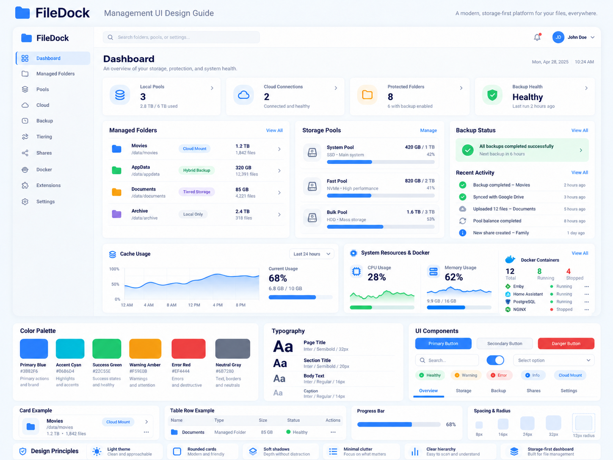

# FileDock Management UI design requirements

**Feature**: [001 — Core Appliance Foundation and OS Setup](./spec.md)
**Approved reference**: User-supplied Management UI Design Guide, 2026-10-13
**Requirement coverage**: FR-124–FR-135; US11; SC-027–SC-031

## Authority and scope

The reference governs visual identity, page composition, and component appearance across the
management system. The feature specification governs behavior, permissions, storage semantics,
health, and recovery promises. The screenshot's sample counts, paths, names, dates, charts, apps,
and activities are illustrative. The outer "Management UI Design Guide" title and the palette,
typography, and component demonstration panels are documentation, not appliance dashboard content.

This revision changes presentation requirements. It does not add storage modes, cloud sync,
background pool balancing, application templates, backup features, or monitoring data sources.
A screen must show a real value, an explicit empty/unavailable state, or omit an inapplicable widget.

## Visual foundations

| Element | Required treatment |
| --- | --- |
| Overall theme | Light, clean, storage-focused; pale cool background, white content surfaces, dark navy headings, muted secondary text |
| Primary blue | `#3B82F6`; brand, primary actions, active navigation, links, capacity bars |
| Accent cyan | `#06B6D4`; limited supporting highlights |
| Success green | `#22C55E`; confirmed successful or healthy states |
| Warning amber | `#F59E0B`; attention, degraded state, protection warnings |
| Error red | `#EF4444`; failures and destructive actions |
| Neutral gray | `#6B7280`; secondary information, neutral borders and states |
| Typeface | Inter, with a readable sans-serif fallback; the rendered UI must work without downloading fonts from the internet |
| Page heading | 32 px, semibold |
| Section heading | 20 px, semibold |
| Body | 16 px, regular |
| Caption | 14 px, regular |
| Spacing | An 8 px rhythm, principally 8/16/24/32 px for gaps and padding |
| Card radius | 12 px |
| Cards | Rounded white surfaces, subtle cool borders, soft shadows; avoid heavy outlines or dense decoration |
| Icons | Consistent simple folder, storage, cloud, service, and settings symbols; meaningful actions retain a text name |

Typography values are the desktop baseline; smaller screens may scale headings while preserving
readability and hierarchy. The reference's tinted icon tiles, pale blue selection backgrounds,
mode badges, and slim progress bars are part of the visual language. Text, control boundaries,
and focus indicators must remain readable; using a darker shade for text or contrast is permitted.
Success/warning/error meaning is never conveyed by color alone. Mode colors identify a mode and
must not imply that its data is protected.

## Application shell and navigation

On desktop, use a left sidebar with FileDock branding and icon-plus-label navigation, a top bar,
and a main content area. The active destination has a pale blue background, blue label/icon,
and an accent edge or equivalent clear selection indicator. Each page starts with a title and a
short description. Preserve the shell while moving between authenticated pages.

The top bar contains the signed-in identity and account actions. A search field and alert control
may occupy the positions in the reference when their corresponding behavior is available.
Search, if offered, finds supported resources/settings and navigates to actual results; it does
not search user file contents. The alert control opens real alert information. Omit unavailable
controls rather than showing a decorative input or bell with an invented count.

Use these navigation labels and order for the corresponding available destinations:

| Reference destination | Product meaning and scope |
| --- | --- |
| Dashboard | Appliance health, protection exposure, and supported storage overview (US1/US3) |
| Managed Folders | The existing managed-folder definitions and six-section flow (US8) |
| Pools | System Pool and data pools, with actual capacity and limits (US9) |
| Cloud | Connections, connectors, and routes (US9/US10) |
| Backup | Available backup behavior; full Hybrid Backup is feature 002 |
| Tiering | Available tiering behavior; full Tiered Storage is feature 003 |
| Shares | Supported export/access management (US9) |
| Docker | Supported container applications (US9) |
| Extensions | Subsystems and extensions (US6), including current service health |
| Settings | Administrators, tokens, network restrictions, appliance state/recovery, and diagnostic tools as implemented (US2/US4/US5/US7) |

Show enabled destinations for implemented functionality. An implemented area with no configured
resources still has a useful empty state. A feature that is not yet implemented or has no available
provider is omitted, or explicitly identified as unavailable without a working navigation action.
Logs, audit, operations, alerts, and recovery remain discoverable through the relevant destinations;
none may disappear simply because the sample sidebar does not name it.

## Dashboard composition

Use the reference's hierarchy, adapted to available information:

1. A page heading and a concise description of storage, protection, and appliance health.
2. A row of compact summary cards with an icon tile, label, primary value/status, and supporting
   detail. Pool/connection/folder counts and protection summaries appear when supported. Core,
   Management, container runtime, and built-in subsystem health remain visible in the current P1
   increment even before folder and pool management is implemented.
3. Below the summaries, white panels for relevant folder and pool lists, protection/backup status,
   and recent activity. Rows use clear names, secondary paths/details, mode/status badges, compact
   numeric values, and a genuine detail link when one exists.
4. Resource/cache charts and container summaries may occupy a lower row when real measurements
   and corresponding features are available. Missing history is shown as unavailable; a single
   current measurement must not be drawn as a fabricated historical trend.

Do not force a fixed number of cards or fill gaps with example data. Counts must identify what they
count, including the distinction between the System Pool and data pools. Used/total values must
use consistent units. Capacity bars express that named resource's actual percentage; the System
Pool must still show its two limits, effective capacity, and limiting factor under FR-099.

Dashboard success banners must state their scope. A successful folder backup must not imply that
all folders or appliance state are protected. Preserve warnings about missing remote appliance
state, local-only exposure, stale recovery points, basic claim safety, missing notification channels,
and Core connection loss. A colored "Protected" badge cannot override the recorded protection state.

## Shared components and flows

- Primary buttons are blue; secondary buttons are light/neutral; dangerous actions are red and
  keep the existing confirmations and guardrails. Provide visible hover, focus, busy, and disabled
  states. A chevron or "View all" link only appears when it leads somewhere useful.
- Inputs, selects, switches, tabs, cards, tables, dialogs, and notices use the same type scale,
  spacing, border/radius treatment, and state colors. A switch reflects the saved state and makes
  an in-progress or failed save visible; it must not falsely appear committed.
- Status badges combine a label with an icon or shape: Healthy, Warning/Degraded, Failed/Error,
  Stopped, Unknown/Unavailable, and any existing domain-specific states. Preserve precise state
  names where they matter; never turn Unknown into Healthy for visual consistency.
- Setup, sign-in, recovery-key download, administrator/token forms, network settings, and later
  folder/storage/recovery flows inherit the same design language. Their required fields, sequence,
  authorization, and warnings remain as specified. Secrets retain their existing one-time display
  and masking rules.
- Empty states describe what has not been configured and offer a supported next action. Loading
  states identify pending information. Error and stale states describe the problem and retain
  recovery actions. Preserve useful visible content and focus when live information changes.
- At narrow widths, navigation collapses into an accessible menu, summary cards wrap, and panels
  stack in the same reading order. Tables may scroll within their own region. Main page content
  must not require sideways scrolling at 360 px width or at 200% zoom on a 1280 px-wide viewport.
- All essential interactions work by keyboard, with visible focus and accessible names. Ordinary
  text has at least 4.5:1 contrast, large text at least 3:1, and control/focus indicators at least
  3:1 against adjacent colors. Touch targets are at least 44 by 44 px. Charts have a textual value
  summary; optional motion respects reduced-motion preferences.

## Revision and planning impact

This guide applies to every implemented management screen and future screen in feature 001.
Existing Phase 1–5 completion marks record the earlier implementation and validation; they are not
proof that the new visual requirements are implemented. Reconcile the plan, UI tasks, and visual
acceptance checks with this revision before beginning the redesign. Keep the completed service,
security, recovery, and data-plane work as the functional foundation.
