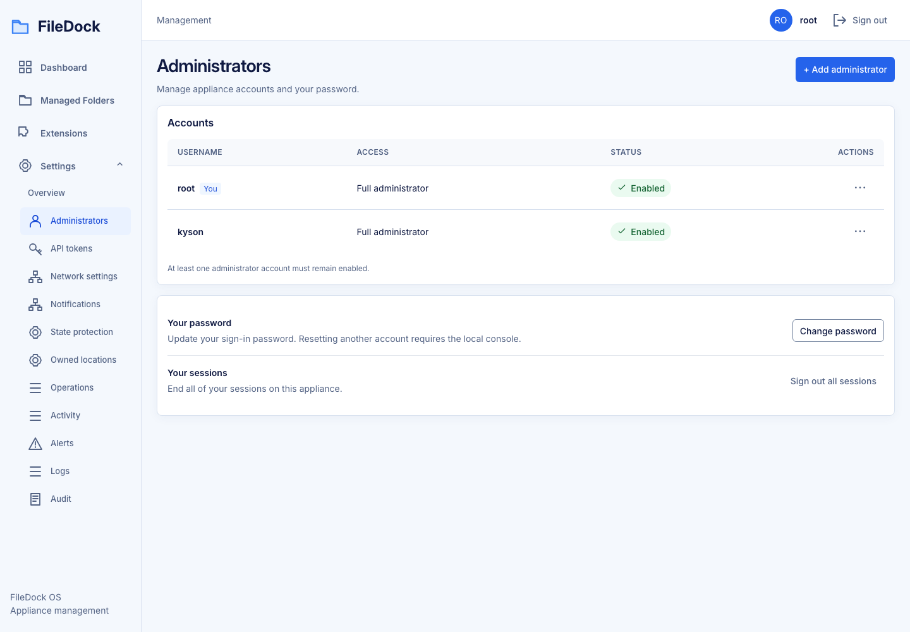

# UI layout acceptance — 2026-10-15

## Scope and inventory (T236)

Increment requested: T236–T251 only. Later story migrations and full-system Linux/VM/novice
acceptance T252–T272 remain outside this implementation increment. Prior completion/evidence is
preserved. Current checkout: main. No VM changes or deployment are part of this increment.

Implemented routes: Dashboard, Managed Folders, Extensions, Settings Overview, Administrators,
API tokens, Network, State protection, Owned locations, Operations/detail, Logs, Activity, Alerts,
Notifications and Audit. Later storage/cloud/shares/apps pages are not enabled. Folder editor URLs
belong to T262; this increment preserves the current folder functionality.

Design authority: ui-layout-revision.md and .interface-design/system.md. Three boards under
assets/ui-layout-2026-10-15 are references, not screenshots. Corrections: one selected leaf (not
Settings parent), Operations stays a link, six-section folder full page reserved for later increment,
Hybrid importance remains visible, compact controls keep 44px targets. Sample data never ships.

Stack: existing React19/TypeScript5/Vite8/TanStack Query, native controls/dialog, bundled Inter.
Exact installed tool/browser versions and executed results are recorded below after validation.
No UI framework, router, collector, provider or backend API is added.

## Evidence matrix

| Area | Status |
| --- | --- |
| Test-first regressions | PASS: initial8 failed as expected; final46 tests pass |
| Shared controls/tables/dialog/state | PASS: unit contracts and browser geometry/focus |
| Single nested navigation | PASS: exact current leaf, no content navigation rail; current routes preserved |
| Accounts/tokens/network/overview | PASS: summaries/lists plus focused dialogs, errors/security/drafts |
| Dashboard/public density | PASS: inherited shared tokens/styles; desktop/mobile candidates reviewed |
| Local lint/unit/type/build | PASS:46 unit tests, lint, TypeScript/Vite production build, formatting |
| Desktop/mobile visual and keyboard check | PASS:5 Chromium scenarios and captured pages; supplemental macOS evidence only |
| Canonical Linux baselines / actual200% zoom / full accessibility | Pending T267/T269 |
| Real VM/offline/runtime/novice | Pending T270/T271; prior Phase8 gaps remain separate |

## Component design checkpoints (before implementation)

All components serve the appliance administrator: scan actual resource state, then make one change.
Palette is the existing navy/white/cool-gray/blue; semantic warning/error colors keep their meaning.
Depth is subtle shadows and quiet borders; surface levels are canvas, panel, overlay; inset fields
receive data. Local Inter and the saved ratio/weight hierarchy keep labels subordinate to values.
Base grid4px, dense16px insets and24px sections keep the operational console calm.

| Components | Focal hierarchy / intent / dimensions |
| --- | --- |
| Button / RowActions | One primary action;36/40px visual with44px target; quiet named ellipsis; menu above table, no hover-only behavior |
| DataTable / TableToolbar / SettingsRow | Resource identity first, shared header/cell alignment,56px growing rows; short summaries and compact trailing actions |
| Dialog / Field / PageHeader | Task title then fields; one footer;440–480px bounded overlay, associated errors, focused input, preserve drafts |
| Navigation / Sidebar / AppShell / TopBar | One current leaf;224px single sidebar with indented Settings; identity/sign-out visible; mobile one disclosure |
| Admins / Tokens / Network / Settings | Saved list/summary first; explicit action reveals editor, errors stay with editor; secrets memory-only |
| Dashboard / AuthLayout / Setup / Sign-in / Recovery | Actual health or required form leads; shared density and local brand; warnings/flow order unchanged |

First regression run:8 tests failed as expected,28 passed; failures include multiple active nav
items, missing metadata/RowActions/dialog props, and missing dialog-driven account/network behavior.

## Completed first increment — T236–T251

- Shared compact controls retain44px real button boxes;36/40px visual faces are drawn inside them.
  No overlapping pseudo-target extensions. Header/cell alignment comes from shared column metadata.
- Action track increased from the design's initial56px to96px after visual review caught a wrapping
  Actions heading. This keeps the44px button plus table insets readable, still a compact single action.
- Native dialog has named title/description, first field/error focus, one Cancel/submit footer,
  busy protection, dirty confirmation, bounded body, focus trap/return and associated field errors.
- Settings disclosure uses native details/summary and nested links in the sole Sidebar. Only the
  exact current link is selected; operation detail belongs to Operations. Existing App dispatch and
  one subscription needed no replacement. All implemented routes remain available.
- Dirty-navigation guard checks hash navigation and native Back/Forward, restores the original
  history position on cancellation, and permits explicit auth reset. Refresh uses native unload
  warnings. Drafts/credentials never persist in browser storage.
- Accounts/Password/Tokens/Network summaries lead; short edits use dialogs. Password submission,
  mismatch/failed-save draft retention, last-admin guard, token secret-once/expiry clearing and
  network disconnect payload remain covered. Sign out all sessions is a deliberate confirmation.
- Settings Overview is grouped concise link rows. Dashboard/public setup/sign-in/recovery inherit
  shared styling; their domain behavior/sequence was retained and existing flow tests pass.
- Folder/editor, extension, notifications, recovery and operations-specific migrations T252–T264
  remain unchecked. Their existing components still work through the shared API; no new folder
  routes/pages or unimplemented providers were enabled by this increment.

## Commands and actual outcomes

Environment: macOS arm64, Node22.18.0, pnpm10.15.0, Playwright1.64.0 installed Chromium.

| Command | Result |
| --- | --- |
| Initial requested regressions |8 failed/28 passed before corresponding features; expected red stage |
| `pnpm -C web test` | PASS:13 files,46 tests |
| `pnpm -C web lint` | PASS |
| `pnpm -C web build` | PASS: TypeScript + Vite; local Inter asset retained |
| `pnpm -C web format:check` | PASS |
| `FD_BASE_URL=http://127.0.0.1:5194 pnpm -C web exec playwright test ui-layout-increment.spec.ts --workers=1` | PASS:5 scenarios;1440px/360px, columns/targets/focus/dialogs, token dismiss, native Back/Forward cancellation, public/dashboard reflow |
| `git diff --check` | PASS |

Browser fixtures explicitly represent absent restore reports as204 and recovery coverage as actual
fixture fields, rather than rendering an invented report from an empty object. Prototype values
and fixture imports remain in documentation/test paths. No production sample fallbacks were added.

### Reviewed candidates

Captures are saved under [implemented-first-increment](./assets/ui-layout-2026-10-15/implemented-first-increment/README.md).
These are supplemental actual frontend captures, not the original generated prototypes.

[Administrator dialog — phone](./assets/ui-layout-2026-10-15/implemented-first-increment/add-administrator-360.png) ·
[Settings overview — phone](./assets/ui-layout-2026-10-15/implemented-first-increment/settings-360.png) ·
[Dashboard — phone](./assets/ui-layout-2026-10-15/implemented-first-increment/dashboard-360.png)

Visual review: removed the duplicate rail and multi-selection, clear primary account table, compact
aligned action column, modal not clipped at360px, no main horizontal overflow. Panel/control tokens
match the approved quiet composition. Current resource/protection/exposure semantics remain separate.

Not run: old screenshot pixel comparisons (their layout is superseded), canonical Linux baselines,
actual200% browser zoom, complete screen-reader/contrast audit, PVE/offline release deployment,
real provider-backed operations or novice sessions. These remain under T267–T271 and older pending
evidence; successful local mocks do not certify backend/VM/runtime acceptance. The temporary Vite
server is stopped after this review. No VM, commits, releases or PRs were created/modified.

Final dashboard check also found that the actual `/restore/report` endpoint returns204 when absent.
The existing query now normalizes that to null (instead of undefined rejected by TanStack Query),
with a regression test. It does not create a report or change recovery semantics. Final local total:
46 unit tests and5 browser scenarios passed. Temporary preview stopped after validation.
