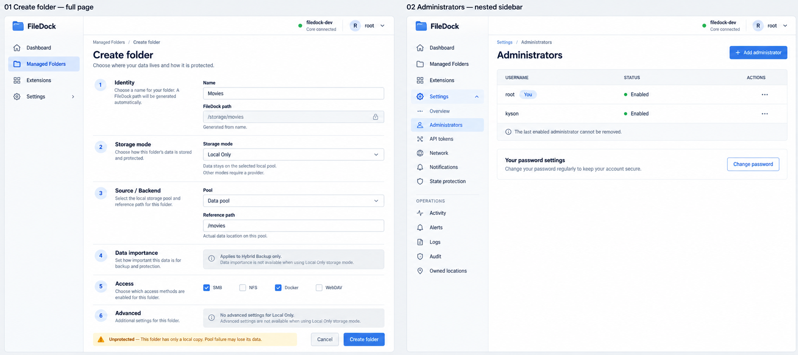
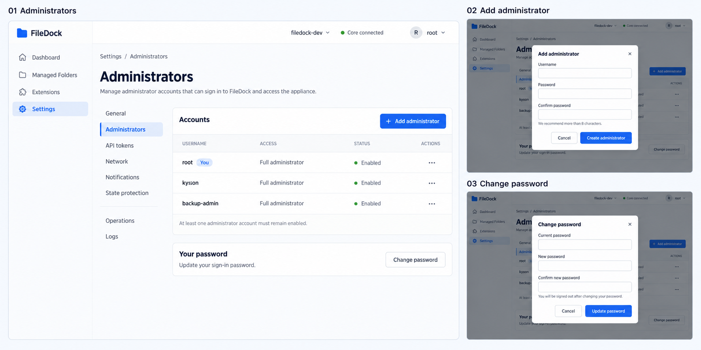
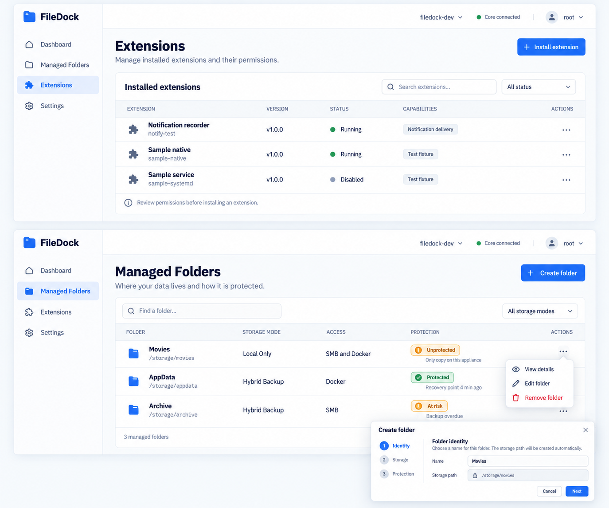

# UI layout revision — 2026-10-15

**Feature**: 001 / US11, applied across US6–US8 and all implemented screens.  
**Status**: user-approved direction; implementation and browser acceptance pending.  
**Plan**: [plan.md](./plan.md) · **Interface**: [management-ui.md](./contracts/management-ui.md)  
**Reusable patterns**: [system.md](../../.interface-design/system.md)

## Intent and design exploration

The administrator is configuring a self-hosted storage appliance, often between installation and
VM testing. They need to locate a resource, understand protection/exposure, and perform one change
without scanning unrelated open forms. The interface should feel calm, precise, and operational.

- **Domain**: storage pools, mounted paths, managed folders, durable recovery points, capability
  providers, appliance health, and owned locations.
- **Color world**: white equipment surfaces, cool gray structure, navy labels, blue folder markers,
  green healthy indicators, amber caution indicators, red failure/destructive signals.
- **Signature**: names paired with FileDock paths; storage mode separate from protection;
  exposure beside protection; provider capabilities beside extension identity; the generated path
  immediately below its name. These five treatments make the storage appliance recognizable.
- **Rejected defaults**: open forms on every card → summaries plus deliberate actions; duplicate
  navigation rails → one nested sidebar; oversized repeated row buttons → compact actions with
  accessible targets. Decorative metrics and unsupported search remain excluded.
- **Direction**: preserve local Inter and FileDock blue; use a tighter operational scale, quiet
  surfaces, one focal list/form per page, and deliberate whitespace between related groups.

## Prototype gallery and precedence

These generated raster references are retained documentation assets, not screenshots of running
code, test evidence, or production artwork. Names, statuses and data are illustrative. They were
created with the built-in image generation tool. No additional image is needed to settle the
approved layout; narrow-screen behavior is specified below and must be checked in real browsers.

### 1. Approved shell and full-page Create Folder

This is the latest layout direction. Apply these corrections to the drawing:

- Settings is a disclosure parent, not a second active destination. Only the actual leaf gets the
  selected fill and `aria-current="page"`. Parent expansion gets a chevron, not a selected pill.
- Operations must retain its own navigable list entry; a group label is not a replacement for it.
  Preserve all implemented destinations, even when a drawing omits one.
- Folder sections remain in one scrolling page. No tabs, next/back wizard, modal, secondary rail,
  or collapsed section is used to hide required inputs. Six headings stay visible in document order.
- Importance input exists only for Hybrid Backup; other modes use the pictured applicability note.
- Compact visual controls still have nonoverlapping 44 × 44 px minimum effective targets.
- Password wording is 'Update your sign-in password'; do not introduce a periodic-change policy.

### 2. Administrator actions and focused dialogs

Retain the list, compact security row, Add administrator dialog and Change password dialog.
The second navigation rail in this earlier board is superseded by prototype 1. Preserve password
confirmation, advisory length, current-password requirement, sign-out behavior and last-admin guards.

### 3. Extension/folder table density and row actions

Retain paired name/path or name/identifier cells, aligned columns and compact row actions.
The inset folder wizard is superseded by prototype 1. Hybrid Backup still requires a visible
importance column/value in every folder listing. Protection states need distinct text, glyph and
explanation: Unprotected means no protection, At risk means expected protection is overdue/failed.
No screenshot state enables an unavailable provider or makes sample protection true.

**Precedence**: latest explicit user instructions and functional spec → written current UI contract
and this revision → prototype 1 for shell/form composition → prototypes 2/3 for local patterns →
original 2026-10-13 guide for identity. Raster errors never override behavior or accessibility.

## One navigation tree

Desktop: one 224 px sidebar, 64 px utility bar, remaining width for content with 24 px inset.
Order today: Dashboard, Managed Folders, Extensions, Settings. Add later areas in the original
guide's order only when implemented. Settings has an Overview link plus nested existing child links:
Administrators, API tokens, Network, Notifications, State protection, Owned locations, Operations,
Activity, Alerts, Logs, Audit. They are all within the single sidebar; quiet noninteractive grouping
labels may improve scanning. No in-content Settings navigation strip or secondary column remains.

Keep links distinct from the Settings expand/collapse button. Opening a Settings route reveals
its child; operation detail selects Operations. Folder create/edit selects Managed Folders.
Exactly one navigable destination is current, including Settings Overview. Settings expansion is
not selection. Retain hash URLs, refresh/back/forward and public authentication gates.

At 360 px or enlarged text, the same tree becomes one accessible disclosure overlay/drawer.
Do not retain a hidden second rail. Scroll a long tree independently without hiding account/sign-out
or main content. Escape/selection closes the overlay, hidden links leave tab order, and focus returns
to its trigger. Ordinary navigation uses links and disclosure semantics, not ARIA application menus.

## Full-page folder create/edit

Planned routes: `#/folders/new` and `#/folders/{id}/edit`, with encoded exact resource IDs.
Both are routed pages sharing FolderForm, not forms appended below the folder list. Breadcrumb
returns to Managed Folders. All six sections appear sequentially:

| Section | Content and conditions |
| --- | --- |
| 1 Identity | Name; generated, read-only `/storage/<normalized-name>` preview; unique-name/path feedback |
| 2 Storage mode | Available mode selector; missing-provider reasons and data semantics |
| 3 Source / Backend | Mode-specific pool, reference path, cloud connection/remote path and backup destination |
| 4 Data importance | Explicit choice only in Hybrid Backup; otherwise short applicability note; no hidden required field |
| 5 Access | Supported protocol/Docker choices; disabled-provider explanation and dependency guards |
| 6 Advanced | Relevant backup/retention/override/cache/tiering controls in-place; no applicable settings becomes a short note |

Desktop sections use a 200–240 px explanation column and a flexible input column capped near
640 px. This is form composition, not another navigation rail. At narrow widths headings, help
and fields stack in reading order. Use one form submit. All required sections remain expanded;
optional advanced groups can be visually grouped without tabs or hiding required validation.

Keep Cancel and Create folder/Save changes in a modest footer; no fixed footer obscures validation
or warnings. On invalid submission focus a named error summary with links to fields; retain values.
Dirty navigation/cancel asks before discarding, including browser back; no secrets persist in storage.
Outages preserve the draft and disable submission. Server validation, ETags/conflict handling, lower
importance/mode acknowledgements, typed Critical deletion, System Pool/exposure warnings, and
capability/dependency guards remain authoritative. Longer forms never get squeezed into a dialog.

## Page cleanup inventory

| Surface | Main content | Action presentation |
| --- | --- | --- |
| Administrators | Accounts table and compact Your password row | Add administrator / Change password dialogs; row enable/disable/remove controls; destructive confirmation |
| API tokens | Token list with scope/expiry/revocation | Create token dialog followed by one-time secret view; revoke confirmation |
| Extensions | Actual core/built-in/optional subsystem lists and capabilities | Install/upgrade button opens focused package/permissions flow; if too long, use a dedicated page; compact row actions; preserve all restrictions |
| Managed Folders | Single table with path, mode, Hybrid importance, access, protection/exposure | Create/edit routed full pages; deletion confirmation retains dependency errors |
| Notifications | Channel list and missing-channel notice | Add/edit dialog, explicit test action and delivery/error result |
| Network | Saved listener summary and console recovery help | Configure action opens focused dialog with disconnect acknowledgement; keep full form on page if required fields overflow |
| State protection / locations | Real recovery coverage/copy/location summaries and warnings | Save recovery point action; reauthentication dialogs for secrets; connection/destination editors use dedicated pages when long; takeover stays explicit |
| Logs / Activity / Audit / Operations / Alerts | One primary list/timeline and compact supported filters | Quiet toolbar/filter actions, pagers and row details/ack; diagnostics download retains Full permission and audit |
| Settings Overview | Grouped concise settings rows with descriptions | Real links; avoid a repeated grid of large form cards |
| Dashboard / public setup / sign-in / restore | Existing truthful summaries and required flow | Apply shared sizing/alignment, preserve recovery/setup sequence; no invented metrics or new modal wizard |

A destructive action never shares one-click behavior with harmless navigation. Menu items need
names contextualized with resource identity; ellipsis is not an accessible name. Do not replace
functional export/upgrade/configuration controls with sample-only mock menu items.

## Implementation slices for the next task pass

1. Shared compact token scale, Button size/quiet/icon variants, DataTable column metadata and
   toolbar/row actions; verify component keyboard, targets, long values and busy/error states.
2. Correct exact current-route matching and nested Settings disclosure; remove AppShell settings-nav;
   preserve one live subscription and all routes. Add folder new/edit hashes with explicit matches.
3. Convert Administrators, Tokens and Notifications to summary/list plus focused dialogs; preserve
   form/security behavior. Extend Dialog with a single controlled footer and correct form focus.
4. Move folder create/edit to routed full pages and compose six expanded sections; preserve data,
   generated path, mode visibility, confirmations, validation and conflicts.
5. Migrate remaining implemented lists/cards/settings, extension package workflows and recovery
   editors to the same patterns; no per-page CSS exceptions for shared alignment.
6. Run full screen/state, keyboard, responsive, live continuity, offline and real-appliance review.

This is design, not newly completed work. Do not reset or check off existing tasks. The next
`speckit-tasks 001` pass appends fresh IDs after inspecting the current highest ID.
